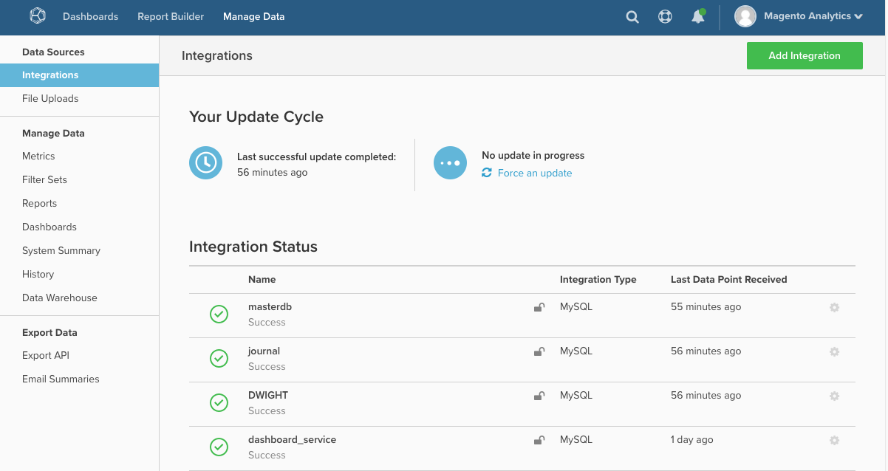

# MBI: Reautenticação de integrações

Este artigo fornece soluções para reautorizar uma integração a fim de conceder à Magento Business Intelligence (MBI) os privilégios necessários para extrair dados de um serviço de terceiros. A reautorização é necessária quando esses privilégios são revogados.

## Integrações de banco de dados e SaaS

Para obter listas de integrações de banco de dados e SaaS, consulte [Conectando dados externos usando uma integração](https://experienceleague.adobe.com/pt-br/docs/commerce-business-intelligence/mbi/analyze/saas/integrations) na documentação do desenvolvedor. (Ao abrir a página, use o índice à esquerda para navegação).

## Problemas de conexão?

A autorização de uma integração concede ao MBI os privilégios necessários para extrair dados de um serviço de terceiros. A reautorização é necessária quando esses privilégios são revogados.

Isso pode ocorrer devido a várias razões:

* um problema com o serviço de terceiros
* expiração do token de autenticação
* uma alteração feita em sua conta administrativa
* ou um problema interno no MBI

O status de todas as integrações está na página Integrações ( **Gerenciar dados > Integrações** ):

Para autenticar novamente, talvez seja necessário inserir novamente as credenciais da conta. Em alguns casos, pode ser necessário gerar novas chaves de API para a integração do problema. Clique no nome da integração do problema para iniciar o processo de reautorização.

Se o problema persistir, [envie um tíquete de suporte](https://experienceleague.adobe.com/pt-br/docs/support-resources/adobe-support-tools-guide/adobe-commerce-support/adobe-commerce-help-center-user-guide#submit-ticket).
