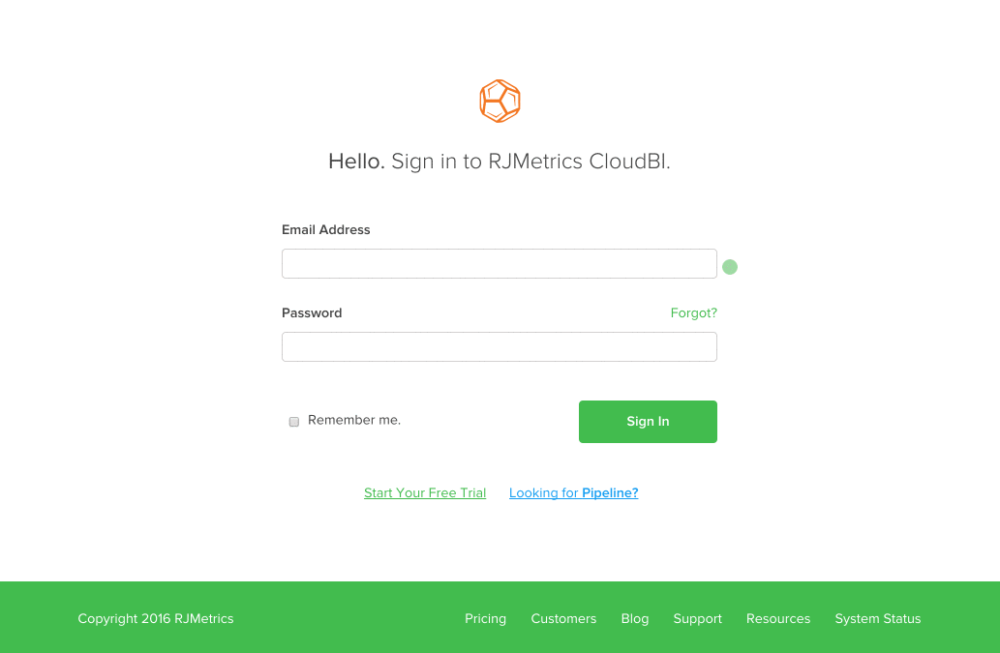

# Solução de problemas de bloqueio de conta do Adobe Commerce Intelligence

<!--
BOB: Is this in TOC?
-->

Este artigo fornece soluções para o bloqueio de conta da Commerce Intelligence. Primeiro, precisaremos determinar se é um defeito, uma falha temporária ou algo diferente. Seguir as etapas abaixo ajudará você a entrar em sua conta o mais rápido possível.

## Verifique se o seu endereço de email está correto

Verifique novamente seu endereço de email para saber se o endereço de email que você está tentando usar para fazer logon está associado a uma conta existente do Commerce Intelligence. Talvez seja necessário solicitar que um Administrador da conta confirme que não há erros de digitação no endereço de email.

Depois de confirmar que o endereço de email está correto, tente fazer logon novamente usando [este link](https://dashboard.rjmetrics.com/v2/session/create#/).

## Tente redefinir sua senha

Se você verificou que está usando o email correto, tente redefinir sua senha. Você pode usar o **Esqueceu?** na página de logon da seção anterior para acionar um email de redefinição de senha.

Se não vir o email no início, verifique a pasta de lixo eletrônico. Às vezes, até mesmo emails bem-intencionados podem ser confundidos com lixo eletrônico. **Observe que os links de acesso temporário nesses emails são válidos apenas uma vez!**

Se ainda estiver bloqueado, verifique se seu endereço de email está correto e se você está usando o link correto do email de redefinição. Recomendamos tentar o seguinte **antes de solicitar outra redefinição e tentar fazer logon novamente:**

* Limpe o cache do navegador, os cookies e as senhas salvas
* Desative temporariamente qualquer software de bloqueio de anúncios

## Documente os erros e entre em contato com o suporte

>[!NOTE]
>
>Essa etapa nem sempre é necessária, mas concluí-la proativamente pode reduzir o tempo gasto para fazer uma solicitação de suporte.

Se você ainda não conseguir acessar sua conta, recomendamos verificar se há erros e enviar um tíquete para nossa equipe de suporte. Como você pode fazer isso? Ao abrir as ferramentas de desenvolvedor do seu navegador e capturar a tela de todos os erros exibidos no console ou na janela de log do site. Na GIF abaixo, estou abrindo as ferramentas do desenvolvedor para o Google Chrome:

No exemplo acima, usamos o método mais comum (**clique com o botão direito** > **Inspecionar**) para abrir o console. Se o navegador não tiver esse método ou se você precisar de ajuda, use os links de documentação abaixo para o navegador da Web que você está usando:

<table>
<tbody>
<tr>
<td><a href="https://www.technipages.com/mac-os-x-enable-web-inspector-in-safari">Safari</a></td>
<td><a href="https://developer.mozilla.org/en-US/docs/Tools/Web_Console/Opening_the_Web_Console">Firefox</a></td>
<td><a href="https://developers.google.com/web/tools/chrome-devtools/?hl=en">Chrome</a></td>
<td><a href="https://www.opera.com/dragonfly/documentation/">Opera</a></td>
<td><a href="https://msdn.microsoft.com/en-us/library/gg589512(v=vs.85).aspx#OpeningTools">Internet Explorer</a></td>
</tr>
</tbody>
</table>

Em alguns navegadores, abrir as ferramentas do desenvolvedor pode não exibir automaticamente o console; o código do site pode ser exibido primeiro. Se isso acontecer com você, clique na opção Console na janela do desenvolvedor e faça capturas de tela de todos os erros exibidos lá.

Envie um tíquete para nossa Equipe de suporte com as **capturas de tela de erro** e o **endereço de email da sua conta da Commerce Intelligence**.

## Não vê erros ou está apenas perdido?

Não se preocupe! Registre um novo tíquete de suporte (certifique-se de incluir o endereço de email de sua conta da Commerce Intelligence) e você será reinserido em sua conta o mais rápido possível.

## Tópicos relacionados em nossa base de conhecimento de suporte:

* [Adicionar um novo usuário e definir permissões](https://experienceleague.adobe.com/docs/commerce-business-intelligence/mbi/administrator/user-mgmt/user-management.html?lang=pt-BR)
* [Como atualizar meu endereço de email ou senha?](https://experienceleague.adobe.com/docs/commerce-business-intelligence/mbi/administrator/user-mgmt/create-user.html?lang=pt-BR)
* [Como redefinir minha senha?](https://experienceleague.adobe.com/docs/commerce-business-intelligence/mbi/administrator/user-mgmt/reset-password.html?lang=pt-BR)
