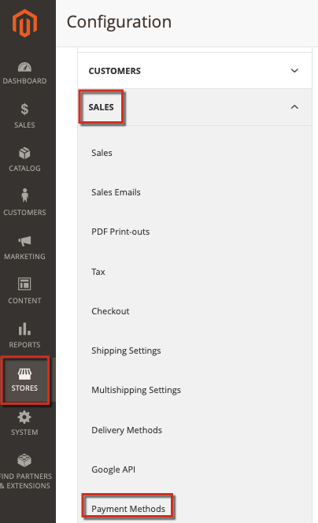

# Solução de problemas do PayPal no Adobe Commerce

Este artigo fornece soluções para problemas com o processamento de pagamentos via PayPal, especialmente a solução PayFlow Pro. Algumas recomendações neste artigo podem parecer óbvias. Solicitamos que você tente as opções de solução de problemas listadas nesta base de conhecimento e inclua todas as informações em todos os tíquetes inseridos. Os engenheiros de suporte da Adobe Commerce ou do PayPal solicitarão que você execute essas etapas ao diagnosticar seus problemas.

## Problemas comuns

A maioria dos problemas com pagamentos do PayPal tem sintomas semelhantes: depois de especificar os detalhes do cartão de pagamento e prosseguir para o check-out, o pagamento não está sendo processado. Em vez disso, pode haver uma mensagem de erro, falha ao processar o pagamento ou até mesmo uma página em branco.

## Verificar suas credenciais, chaves de criptografia e licenças

Possíveis problemas: erros de impressão nos detalhes da conta (nomes de usuário, senhas), contas inválidas, licenças expiradas ou não especificadas, chaves públicas e pessoais inválidas e muitos outros aspectos. Para encontrar esses problemas, você também pode precisar verificar suas configurações de pagamento.

## Aplicar configurações consistentes no Adobe Commerce e no PayPal

Certifique-se de ter aplicado as mesmas configurações e ativado as mesmas funcionalidades nas configurações de conta do Commerce Admin e do PayPal.

### Exemplo de problema de configurações

Ao aplicar a solução Check-out do PayPal Express, as transações baseadas nas respostas AVS/CSC devem ser recusadas no **PayPal Manager** (Configurações de Serviço > Configurar > Opções de Segurança) e no **Commerce Admin** ( **Lojas** > Configuração > **Vendas** > **Métodos de pagamento** ...).

Para obter mais informações, consulte a documentação: [PayPal](https://www.paypalobjects.com/en_US/vhelp/paypalmanager_help/setup.htm) e [Adobe Commerce](https://experienceleague.adobe.com/docs/commerce-admin/stores-sales/payments/paypal/paypal-express-checkout.html?lang=pt-BR) em nosso guia do usuário.

## Permitir transações de referência

Se o método de pagamento do PayPal envolver API com Contratos de faturamento e Transações de referência, verifique se estão ativados e configurados corretamente em suas configurações.

### Solução de problemas adicional

Consulte os seguintes artigos:

* [Solicitação rejeitada pelo gateway do PayPal - problema de fatura duplicado](https://experienceleague.adobe.com/pt-br/docs/experience-cloud-kcs/kbarticles/ka-26838) em nossa base de dados de conhecimento de suporte.
* [Alterar ID de incremento para nova entidade de armazenamento](/help/how-to/general/change-increment-id-for-a-db-entity-order-invoice-credit-memo-etc-on-particular-store.md) em nossa base de dados de conhecimento de suporte.

## Entre em contato com o Suporte para coletar logs de pagamento avançado

Para solucionar problemas complicados de pagamento, a Equipe de suporte da Adobe Commerce pode solicitar a aplicação de uma correção dedicada para ativar o registro de pagamento avançado. Nesse caso, suas etapas devem ser as seguintes:

[Envie um tíquete de suporte](https://experienceleague.adobe.com/pt-br/docs/support-resources/adobe-support-tools-guide/adobe-commerce-support/adobe-commerce-help-center-user-guide#submit-ticket) com os seguintes detalhes:

* Especifique seu problema com o maior número de detalhes possível.
* Liste as etapas que você tentou deste artigo, da knowledge base e de outros recursos. Incluir todos os resultados.
* Solicite um patch de Registro de pagamento avançado (número de referência MDVA-4352) e instruções sobre como aplicar o patch.

Se você receber o patch de Registro de Pagamento Avançado:

* Aplique o patch.
* Colete logs e anexe-os ao seu [tíquete de suporte](https://experienceleague.adobe.com/pt-br/docs/support-resources/adobe-support-tools-guide/adobe-commerce-support/adobe-commerce-help-center-user-guide#submit-ticket).
* Aguarde mais recomendações da Equipe de suporte da Adobe Commerce.
